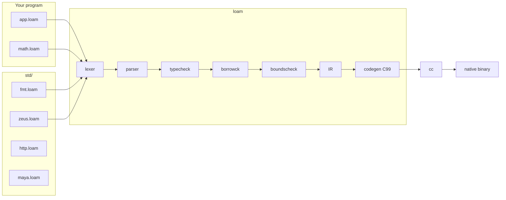

# Loam language

Loam is a memory-safe systems language: Odin-like syntax, Rust-like ownership.
`loam` is written in C11, typechecks a program, lowers it to IR, emits C99,
and invokes `cc`. C is the **platform binding target**, not the language's
semantics.

**One Loam file in, one C file out.** `loamc` compiles, tests, and runs a whole
`.loam` program as a unit; the source is never required to be split into many
files, and no backend other than `cc` is used. The generated C may be large
(a Zeus app is ~2.9 MB), which is fine — the compile path stays small and the
same shape is what a **self-hosting** `loamc` (the compiler written in Loam,
building and testing itself from whole Loam sources) will keep.

C vs Loam: [boundary.md](boundary.md).
Self-improvement phases: [downsides.md](downsides.md).
This file is architecture plus how to write and run programs.

## Architecture



Pipeline, in order:

| Stage | Where | What it does |
|---|---|---|
| Load | `compiler/loader.loam` | Resolve `import "std:bar"` → `std/bar.loam`, relative `"path.loam"` from the importer. Cycles are errors. |
| Lex / parse | `compiler/lexer.loam`, `compiler/parser.loam` | Tokens → AST. |
| Typecheck | `compiler/typecheck.loam` | Names, types, auto-borrow, generics (monomorphized, including nested calls and defaults), `mod.fn` / `mod.global`, method rewrite `n.w(32)` → `zeus.w(n, 32)`. |
| Borrowck | `compiler/borrowck.loam` | Exclusive vs shared, moves, place paths (`p.a` vs `p.b`). Borrows end when the holder is not read again before being overwritten, along any path (NLL-style). Reference escape: no return into the frame, no read after the source's scope, a returned reference keeps its arguments borrowed ([References](#references)). Enforces `#[must_check]`. |
| Boundscheck | `compiler/boundscheck.loam` | Proven in-range indexes skip the runtime trap: a literal in `0..N` for `[N]T`, and `for i in 0..C.len { … C[i] … }` (loop var matched by resolution). Overflow traps likewise drop on a foldable literal op literal (`compiler/ir.loam`). |
| IR | `compiler/ir.loam` | CFG, drops, closures as heap env + fn pointer (`loam_fn`: fn, env, env_size). |
| C | `compiler/codegen.loam` | C99, then `cc`. |

Ownership state (from the spec):

```
Owned ──copy──► Owned
Owned ──move──► Moved
Owned ──&────► Borrowed ──last use──► Owned
Owned ──&mut─► MutBorrowed ──last use──► Owned
Owned ──scope exit──► Dropped   (free boxes / []T / closures)
```

`Box<T>` is not Copy. `[]T` is Copy when `T` is Copy (refcounted buffer,
copy-on-write on `push`). `fn` values are Copy handles. They are freed when
the last owner drops (vectors) or interned for the process (handlers).

### References

Loam has no lifetime parameters. References are **second-class** instead:
they live in parameters, locals, and return values, never in storage that
could outlive their source. `&` and `&mut` take the address of a place: a
variable or a global, through fields, indexes and `*` (`&x`, `&s.f`,
`&v[i]`, `&*p`). A temporary (`&f()`, `&[]int { 1 }`) is an error; bind it
with `let` and borrow the name. Four rules, all checked at compile time:

1. A function cannot return a reference into its own frame: a local, a
   by-value parameter, a local `Box`, or a temporary, by any path (`&x`,
   `&s.f`, `&v[i]`, `&*b`, through a `let`, or through a call). A reference
   parameter or a global may be returned.
2. A struct field, `[]T`, `[N]T`, or `Box<T>` cannot hold a reference. A
   `fn(&T)` field is fine. A generic fn that puts its `T` in a container
   (even only inside its body) cannot be called with `T` a reference, and a
   C hook cannot return one.
3. A reference cannot be read after the binding it points into goes out of
   scope. Aiming an outer reference into an inner block is legal as long as
   it is not read after the block (or is aimed elsewhere first).
4. A returned reference borrows what its reference arguments borrow: while
   `p = first(&v)` lives, `v` cannot be pushed, assigned, or moved. A call
   given `&mut p` may aim `p` at any of its other reference arguments.

Instead of a stored reference, store an owned value, a `Box`, an index into a
list, or a handle (`Signal`). The design and its phases:
[reference-escape.md](reference-escape.md).

## Repository map

```
loam/
  loam/           the language
    src/          compiler (C11)
    std/          language libraries (Loam)
    runtime/      loam_rt (language) + host shims (not library protocol C)
    tests/        compile_pass / compile_fail / golden / draw_golden / inlang / bench
  nob.loam        the build and test tool (`bin/nob`; `nob.sh` forwards to it)
  zeus/           the framework: hosts/ (Cocoa, iOS, Android, Canvas2D), docs/
  tooling/
    tree-sitter-loam/  grammar
    editors/      editor integrations (Zed, Cursor/VS Code)
  examples/
    language/     standalone demo .loam programs (not test fixtures)
    zeus/         zeus apps (gallery, dashboard, myapp scaffold) + full-stack counter example
  bin/loamc       the compiler
  bin/loam-lsp    editor diagnostics / hover (incl. doc comments) / go-to-def / completion / semantic tokens
  bin/loam-fmt     formatter (one style, no options)
```

Language std modules today: `fmt` (print), `math` (`f64` elementary functions), `date`
(`YYYYMMDD` calendar and day numbers),
`thread` (OS threads + `Chan<T>` for CPU-bound work; Send discipline keeps
workers off module state — native/iOS/Android only, wasm `spawn` is a no-op).
`zeus` (UI), `http`, and `maya` (tiny 3D) are packages, imported as
`import "zeus"`, not `import "zeus"`.

Document them with `/** *text */` above each `fn` / `struct`. A single-line
comment is `//` and a block comment is `/* */`. Hover in the editor shows the
doc plus the type.

### Module resolution

There is no `export` keyword. Every top-level `fn`, `struct`, `const`, and
`enum` can be imported. The importer chooses the names.

| Form | Resolves to | Use for |
|---|---|---|
| `import "std:name"` | `packages/loam/std/name.loam` only | language standard library |
| `import "pkg"` / `import "pkg:module"` | package entry, or `src/<module>.loam` inside that package | workspace members, `vendor/` + `loam.lock` |
| `import "pkg:name"` | `vendor/name/name.loam`, searched upward from the entry | explicit vendored form |
| `import "path.loam"` | relative to the importing file | files shipped with this module |
| `import { Name } "path"` | the same file as a full import of `path` | the declarations you name |

`std:` does not search `LOAM_PATH`. That variable is an override for package
roots that are not in the nearest `loam.toml` workspace or in `vendor/`. A
shipped app is the entry file, `vendor/`, and `loam.lock`. A `std:` import of
zeus is an error; the package is `import "zeus"`. `import "fmt"` is not the
language module; that is `import "std:fmt"`.

`packages/loam/std/` holds the language core (`async`, `buf`, `conv`, `date`,
`fmt`, `font`, `intmap`, `json`, `kv`, `log`, `map`, `math`, `net`, `result`,
`str`, `sys`, `test`, `thread`, `unicode`). `zeus`, `zui`, `http`, and `maya` are packages. Their
manifests point at `src/<name>.loam`. Relative imports are for a module's own
siblings (`packages/zeus/src/router.loam` → `"zeuscore/platform.loam"`).

`zeli pkg sync` reads `loam.toml` `[dependencies]` when that section lists
anything, otherwise `loam.deps`, and writes `vendor/` plus `loam.lock` with a
checksum. There is no package registry and no package site. A dependency is a
path in the manifest or in `loam.deps`. A registry, `loam pkg publish`, and
precompiled package caches wait until a site exists.

## How to use the language

Build the compiler once from the repo root:

```
./nob.sh
```

`nob.sh` is only a bootstrap: `cc` builds the committed seed
(`bootstrap/loamc.c`), the seed builds `bin/loamc`, and then it runs
[`nob.loam`](../nob.loam) (`nob build`), which owns the incremental build. The
same program runs the suite (`./bin/nob test`, or `./nob.sh test`).

### 1. Hello

`hello.loam`:

```loam
import "std:fmt"

fn main() {
    fmt.println("hello, loam")
}
```

```
./bin/loamc hello.loam -o hello
./hello
```

`fmt.println` is compile-time lowering to length-based writes. It is not
`printf`.

Useful flags:

```
./bin/loamc app.loam -o app          # binary
./bin/loamc app.loam --emit-c -o a.c # C99
./bin/loamc app.loam --emit-ir -o a.ir
./bin/loamc app.loam --run           # compile and run
./bin/loamc app.loam --target wasm -o app.wasm  # Canvas2D .wasm (clang wasm32)
./bin/loamc --target=ios --run examples/zeus/dashboard/dashboard.loam  # Simulator
./bin/loamc --target=android examples/zeus/counter/android/app.loam  # Gradle project
```

### App C seams

Bodyless fns are not just for std: any fn whose body is missing is an **extern
C hook** (`loam_<module>_<name>`, no Loam body emitted — see
[boundary.md](boundary.md)). Std modules resolve theirs in `loam_rt` / the
runtime headers; an app resolves its own by shipping one C file:

- `runtime/<app>_runtime.c` beside the entry program is compiled and linked
  automatically for native targets (`driver.c`), and
- `LOAM_LINK_EXTRA="path.c …"` appends extra `.c`/`.o` inputs for entries
  that share a seam (CLI tools, smoke tests).

GreenInfer is the working example (`examples/zeus/greeninfer/`): Loam owns
all engine logic; the C file is only the NEON kernel and mmap trampolines.

### Compile time

`loam` itself is fast (tens of milliseconds to typecheck and emit C). Linking
a Zeus app is where the seconds go: generated C is hundreds of kilobytes, and
on macOS a GUI build also compiles Cocoa.

What `loam` does about that:

- Runtime files (`zeus_plat.c`, `zeus_key.c`, `packages/zeus/hosts/desktop/mac.m`) compile once into
  `packages/loam/runtime/.obj/` and are reused until those sources change.
- `ZEUS_HEADLESS=1` (tests) skips Cocoa and uses `-O0` on generated C.
- GUI builds use `-O1` on generated C, not `-O2` (same overflow checks,
  much less optimizer work).

Set `LOAM_TIME=1` to print `check` / `codegen` / `cc` timings on stderr. Set `LOAM_PROGRESS=<file>`
to have each step appended to that file as it starts, for a tool drawing progress; this
is what the `zeli` build panel reads.

`--target wasm` emits a Canvas2D `.wasm` (no WebGPU). Apple `/usr/bin/clang`
has no `wasm32` target; use Homebrew LLVM and `LOAM_WASM_CC`. See
`packages/zeus/docs/spec.md`.

`--target ios` builds an iOS Simulator `.app`. Zeus still paints its own
theme (fill / text / clip / SVG). UIKit is only the window and touch
host — not buttons, navigation bars, or iOS semantic colors. The
dashboard is a full-screen canvas; `zeus.App` size is ignored. Needs
Xcode. Device signing is out of scope.

`--target android` writes a Gradle project that links a JNI Canvas host
the same way: Zeus paints; Android widgets are not used. Layout is in
density-independent pixels. `--run` needs the Android SDK, NDK, Gradle
8.2+, and `adb`. The counter example talks to the Mac backend at
`10.0.2.2:8080` from the emulator.

### 2. Structs, borrows, heap

```loam
import "std:fmt"

struct Counter {
    name: string,
    count: int,
}

fn increment(c: &mut Counter) {
    c.count += 1
}

fn greet(c: &Counter) {
    fmt.println("hello,", c.name)
}

fn main() {
    let mut c = Counter { name: "tick", count: 0 }
    increment(&mut c)     // explicit
    increment(c)          // auto-borrow as &mut
    greet(c)              // auto-borrow as &
    let b = Box::new(42)
    fmt.println("boxed:", *b)
}
```

`let` is immutable, `let mut` is mutable. Passing an owned place to a `&T` /
`&mut T` parameter inserts the borrow. A stored borrow is live only while the
holder may still be read: after its **last use**, or once it is overwritten
before any further read, the borrowed place is free again (NLL-style
liveness, following branches and loops):

```loam
let mut x = 1
let p = &mut x
*p = 2
x = 3            // legal: p is dead after `*p = 2`

let y = 4
let mut r = &x
r = &y           // r no longer borrows x
x = 5            // legal
```

Several names can be bound on one line. Each takes the value in its position,
and `mut` goes on the names that need it:

```loam
let (x, y, z) = (1, 2.5, "hello")
let (a, b): (i32, f64) = (10, 3.14)
let (mut count, name) = (0, "Alice")
let (keep, _) = (first(), second())
```

This is one `let` per name, not a tuple value: the right side must be a
parenthesized list with one value per name, so `let (a, b) = pair()` is an
error. Values run left to right, before any name binds, so in a nested scope
`let (x, y) = (y, x)` swaps the outer pair. `let mut (a, b)` is an error.

A struct may hold itself through a `[]T` or a `Box<T>`, directly or through
another struct; both are pointers, so the type has a finite size. A recursive
`Box` ends in an `Option`, whose bare `none` needs no placeholder value:

```loam
struct Node { kind: int, kids: []Node }
struct Tree { left: Option<Box<Tree>>, right: Option<Box<Tree>>, v: int }

let t = Tree { left: some(Box::new(Tree { left: none, right: none, v: 2 })), right: none, v: 1 }
```

Holding itself inline — `struct A { a: A }`, or through `[N]T` or another
struct's field — is an error: the struct would have infinite size.

### 2b. Error handling: `Result<T>` and `Option<T>`

`std:result` has two checked containers, both `#[must_check]`:

- `Result<T>` — a tagged `{ tag, val, err }`. `tag` is `ResultTag.Ok` /
  `ResultTag.Err`; read `val` only on `Ok` and `err` only on `Err`.
- `Option<T>` — a tagged `{ tag, val }`. `tag` is `OptionTag.Some` /
  `OptionTag.None`.

```loam
import "std:result"

fn half(n: int) -> Result<int> {
    if n % 2 != 0 { return result.res_err("odd", 0) }
    return result.res_ok(n / 2)
}

fn quarter(n: int) -> Result<int> {
    let h = half(n)?          // early-returns on failure
    return result.res_ok(h / 2)
}
```

A `#[must_check]` value dropped without reading a field — or discarded as a bare
expression statement — is a **compile error**, so a failure cannot be ignored.

**`?`** propagates a failure: `expr?` returns the whole container on the bad tag
(`Err` / `None`) and yields the payload otherwise. The enclosing `fn` must
return the same `Result<T>` / `Option<T>` type; there are no exceptions and no
unwinding. Helpers: `result.is_ok` / `is_err` / `is_some`, `result.unwrap` /
`unwrap_or` / `unwrap_some` / `some_or`.

A `switch` over the tag reads each case's payload:

```loam
switch r.tag {
    case ResultTag.Ok:
        use(r.val)
        break
    case ResultTag.Err:
        log(r.err)
        break
}
```

### 2c. `switch`

`switch` is C's `switch`: it jumps to the case whose label equals an integer,
enum, or `bool` value. Labels are integer constants, negatives included:
literals, `Enum.Member`, or `true` / `false`. A value may label only one case.
`case A, B:` is shorthand for `case A: case B:`.

```loam
switch kind {
    case Tint.Ok, Tint.Info:
        draw_ok()
        break
    case Tint.Danger:
        alarm()
        // falls through: danger also draws the bar
    case Tint.Warn:
        draw_bar()
        break
    default:
        draw_ink()
        break
}
```

As in C:

- A case runs on into the next one unless it ends in `break`, `return`, or
  `continue`.
- `break` leaves the switch. `continue` applies to the enclosing loop.
- `default:` is optional and can sit anywhere. If no label matches and there is
  no `default`, the whole switch is skipped.
- A switch need not cover every value, and an enum need not list every member.
  A non-`void` function that runs off its end returns the zero value, as it
  does after an `if` with no `else`.

Dispatch is one indirect jump rather than a series of compares: the switch
reaches the C compiler as a C `switch`, which picks a jump table when the labels
are dense enough (`br_table` on wasm) and a compare tree when they are not.
Compare strings and floats with `if`.

The borrow checker follows fallthrough, so moving a value in a case and again
in the case it falls into is an error.

`http.call` returns `Res<string>` — the older `{ ok, val, err }` shape kept for
that edge; new code should prefer `Result<T>`.

### 3. Arrays and generics

```loam
import "std:fmt"

fn sum(xs: &[]int) -> int {
    let mut s = 0
    for i in 0..xs.len {
        s += xs[i]
    }
    return s
}

fn main() {
    let mut v = []int {}
    push(v, 10)
    v.push(20)
    fmt.println(sum(v))
}
```

`[]T` is a growable vector (`push` / `pop` / `.len`). Copy when `T` is Copy
(refcount on the buffer; `push` copy-on-writes if shared). Index traps unless
the compiler proved the index in range. `struct Pair<T> { a: T, b: T }` is
monomorphized; `Pair { a: 1, b: 2 }` infers `Pair<int>`.

`int` is `i32` and `float` is `f32` by default. Sized widths are also
available:
`i8`/`i16`/`i32`/`i64`, `u8`/`u16`/`u32`/`u64`, and `f32`/`f64`. Numeric
literals are untyped until context gives them one (`let p: u8 = 200`); a
literal that does not fit its target is a compile error. Widths never mix
implicitly: `a: i32 + b: i64` is an error, and conversions are explicit and
call-shaped — `i64(x)`, `f32(x)`, `u8(x)` (also `x as u8`). Converting to a
width that cannot hold the value traps, as does `u32(5) - u32(10)` (unsigned
underflow). Opt out with `wrapping_u8(x)` / `saturating_u8(x)`, or with the
per-width arithmetic builtins `wrapping_add` / `wrapping_sub` / `wrapping_mul`
/ `wrapping_neg` / `wrapping_shl` / `wrapping_shr` / `wrapping_and` /
`wrapping_or` / `wrapping_xor` and `saturating_add` / `saturating_sub` /
`saturating_mul`, whose width comes from their operands. `+ - *` trap on
overflow at every width. `s[i]` is the unsigned byte at `i`. Things that must
stay 64-bit (clocks, hashes, large byte counts) are listed in
`docs/numeric-widths.md`.

### 4. Modules

Quoted imports only. No glob. No `export` keyword: every top-level declaration
can be named. A full import brings the whole module in under its alias; a
selective import names just the declarations you want. The selective form has
no `from`.

| Spec | Loads | Call as |
|---|---|---|
| `import "std:fmt"` | language `fmt.loam` | `fmt.println(...)` |
| `import "zeus"` | the zeus package entry | `zeus.App(...)` |
| `import "zeus:router"` | that module of the package | `router.open(...)` |
| `import "math.loam"` | `math.loam` next to this file | `math.add(2, 40)` |
| `import "../mod/math.loam"` | relative to the importer | `math.add(...)` |
| `import { add } "math.loam"` | the same file | `add(2, 40)` — bare |
| `import { add as plus } "math.loam"` | the same file | `plus(2, 40)` |

The module name is the file stem (`math`), or the name after `std:` / `pkg:`.
For `package:module` the alias is the module stem (`router` from
`zeus:router`). `as` after the path (`import "img.loam" as pic`) renames the
module itself.

A selective import binds only the names listed, and only for bare use; the
module is still loaded under its alias, so `math.add(...)` keeps working. A
listed name must be declared in that module, or in a module it imports, or the
compiler errors at the import rather than at the use site. Struct type names
are already visible in every loaded module, so listing one is documentation
more than necessity; enums, `let`/`const`s, and functions are what a selective
import actually scopes. A full import of a package in a release build warns;
`import { Name } "pkg"` is what lets unused declarations drop out of the binary.

Functions: `mod.fn(...)`. Module-level `let` bindings are places:
`counter.n += 1`.

`lib.loam`:

```loam
let mut n: int = 0

fn bump() {
    n += 1
}
```

`app.loam`:

```loam
import "std:fmt"
import "lib.loam"

fn main() {
    lib.bump()
    lib.bump()
    fmt.println(lib.n)
}
```

Method call `node.w(32)` looks up `w` in the current file, then in imported
modules, and rewrites to `zeus.w(node, 32)` when `w` lives in `zeus`. That is why
`import "zeus"` is enough for widgets and trailing blocks.

### 5. Closures

```loam
fn main() {
    let add = |a: int, b: int| { a + b }
    let n = add(2, 40)
}
```

A Copy capture is captured by copy. A non-Copy **owned** value (`Box`, or a
struct/array/vec of one) is **moved** into the closure env: the source is
consumed, so a later read of it is a use-after-move, and a closure returned from
a function keeps the value live. A reference (`&T` / `&mut T`) cannot be
captured — that would outlive the borrow.

```loam
fn make() -> fn() -> int {
    let b = Box::new(41)
    return fn() -> int { *b + 1 }   // `b` moves into the closure
}
```

`fn` values are Copy handles (shared env). They may be returned or stored. Zeus
intern (`runtime.intern_fn`) memcpy's that env using `env_size`, so a click handler
still sees captured `Signal`s after the stack frame that created the closure is
gone.

### 6. Tests

`std:test` is the in-language test module. `#[test]` marks a parameterless,
value-less fn; `loam test app.loam` compiles a runner that calls every
`#[test]` fn (entry module and imports, in declaration order) through
`std:test`, and the entry file must `import "std:test"`:

```loam
import "std:test"

#[test]
fn addition() {
    test.assert(1 + 1 == 2)
}
```

```
./bin/loamc test tests.loam
# test addition ... ok
# 1 test(s) passed
```

`test.assert(cond)`, `test.assert_eq_int(a, b)`, and `test.assert_eq_str(a, b)`
are ordinary Loam in `std/test.loam`, built on the `panic(msg)` primitive. A
failed assertion traps and the run exits non-zero:

```
test addition ... .../std/test.loam:36: panic: assertion failed (in test addition)
```

A trap aborts the run (there is no unwinding yet — `Boundary` is a later phase),
so the suite stops at the first failure; the name printed before the panic and
the `(in test …)` tag on the message identify which test failed.

The repository's own suite is [`nob.loam`](../nob.loam). `nob test` (or `./nob.sh
test`) builds the compiler and runs the language suites — `compile_pass`,
`compile_fail`, the golden programs and DRAW goldens, `inlang`, and the
`argv`/`fs`/`watch` probes — plus the host checks that sit next to the compiler
(wasm entry points and floats, server/client split, LSP, the self-hosted
lexer). A `compile_pass` fixture must exit 0, and when a `<name>.expected`
sits beside it, print exactly that to stdout. The `zeli`-driven suite (routes,
build, pkg, fmt, serve) is `nob integration`, deliberately not part of `test`:
it is the slow and most environment-sensitive part. Both take `-j N` (default
4) and print each result as it finishes.

### 7. Debug info

Generated C carries `#line` directives pointing at the `.loam` source, so the C
compiler's own warnings and errors name Loam lines. With `LOAM_DEBUG=1`, `loam`
also compiles the native target with `-g`, so lldb / gdb, profilers, and
sanitizers report Loam `file:line` for stack frames and non-panic crashes:

```
LOAM_DEBUG=1 ./bin/loamc app.loam -o app
```

`-g` is off by default, because it inflates binaries.

### 8. Text, Unicode, and fonts

`string` is bytes: `s[i]` is one byte and `s.len` is a byte count. A
character literal is an untyped integer literal holding one byte, so it
compares with `s[i]` directly and takes `u8` in a `u8` context: `'a'`, `' '`,
and the escapes `'\n'` `'\t'` `'\r'` `'\0'` `'\\'` `'\''` `'\"'` `'\xHH'`.
A non-ASCII character is several bytes, so `'é'` is an error; use a string.
There is no `char` type. Three std modules sit above that:

- `std:str` — byte-level helpers: `slice`, `starts_with`, `ends_with`,
  `index_of` / `last_index_of` (and `_byte` forms), `contains`, `count`,
  `trim` (and `_start` / `_end`), `strip_prefix` / `strip_suffix`, ASCII
  `to_upper` / `to_lower` / `eq_fold`, `split`, `lines`, `join`,
  `replace_all`, `repeat`, `pad_start` / `pad_end`, `shell_quote`. Method
  calls rewrite to it, so `url.trim().ends_with(".m3u8")` works after
  `import "std:str"`. Tests: `packages/loam/tests/inlang/str_tests.loam`.

- `std:buf` — build bytes in a `[]u8` with amortized O(1) appends
  (`push_str`, `push_bytes`, `push_int` / `push_i64` / `push_u64`,
  `to_string`); `sys.write_bytes(path, &b)` writes one without making a string.
- `std:conv` — `int_to_str` / `i64_to_str` / `u64_to_str`, radix forms, and
  `parse_int` / `parse_i64` / `parse_u64` returning a `Result` (sign, `0x` /
  `0o` / `0b`, `_` between digits, overflow is an error); `f64_to_str` (the
  shortest text that reads back exactly) and `parse_f64`.
- `std:unicode` — UTF-8 decode and **extended grapheme clusters** (UAX #29):
  `codepoint`, `next_cp`, `prev_cp`, `next_grapheme`, `prev_grapheme`,
  `grapheme_count`, `grapheme_start`. `Input` caret movement, backspace, and
  delete step by cluster, so a Tamil akshara or an emoji ZWJ sequence moves as
  one unit instead of one code point.
- `std:font` — TrueType/OpenType table parsing (`head`, `maxp`, `hhea`, `hmtx`,
  `cmap` formats 4 and 12) and metrics: `glyph_index`, `advance_px`,
  `text_width`, `line_height`, `measure`, `measure_wrap`. `measure` and
  `measure_wrap` are pure functions of (font bytes, pixel size, string), which is
  what makes text layout host-independent. `glyph_run(text)` returns the
  positioned glyph ids a `plat_glyphs` draw consumes. Metrics and runs are
  unshaped (one glyph per cluster), so complex-script widths and ligatures are
  approximate until a shaper lands (`loam_zeus_v2.md` §1.4).

In-language tests live in `packages/loam/tests/inlang/unicode_tests.loam` and
`font_tests.loam`; the font fixture is `packages/loam/tests/fonts/tiny.ttf`,
regenerated by `make_tiny_font.py` beside it.

`zeus.use_font(src)` binds an external font — a file path on desktop, a URL on
the web — so layout measures with `std:font` instead of the host:

```loam
zeus.load_font("Inter", "./fonts/Inter.ttf")   // host draws with it
zeus.use_font("./fonts/Inter.ttf")             // layout measures with it
```

`use_font_bytes(bytes)` binds bytes the app already holds (the web path). Both
return 1 on success; on 0 the host's own measurement stays in effect, so
callers should not assume the face is present.

### Use cases

| You want | Start with |
|---|---|
| A CLI or algorithm | `import "std:fmt"`, `fn main()` |
| CPU-bound work off the UI thread | `import "std:thread"` — `spawn` a closure, return results through a `Chan<T>` drained on the UI thread |
| A desktop UI | [packages/zeus/README.md](../packages/zeus/README.md) — `import "zeus"` |
| A tiny RPC server | `import "http"` (`examples/language/http_server.loam`) |
| A 3D/2D toy scene | `import "maya"` (`examples/language/solar.loam`) |
| Grapheme-correct text | `import "std:unicode"` for cluster boundaries; `import "std:font"` for in-tree metrics |

Corpus you can compile as examples:

- `packages/loam/tests/compile_pass/hello.loam`, `vec.loam`, `globals.loam`, `import_math.loam`
- `examples/language/counter.loam`, `fib.loam`, `http_server.loam`
- Failures the checker must reject: `packages/loam/tests/compile_fail/*.loam`

```
./nob.sh test            # or: ./bin/nob build && ./bin/nob test
```
